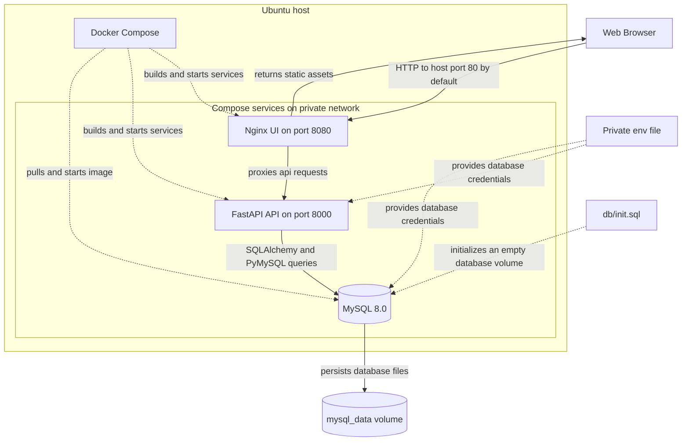
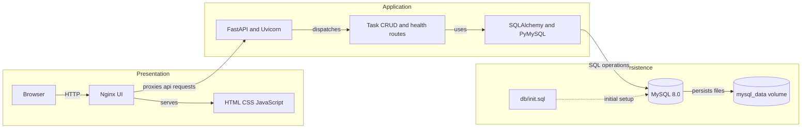

# Architecture Diagram

The application is a Docker Compose stack with a static web frontend, a FastAPI service, and a persistent MySQL database. The diagrams describe the checked-in application and Compose configuration, without the removed deployment automation.

## Application Architecture

<!-- mermaid-checked: no \n, no em-dash/en-dash, no {} in labels, subgraphs are id["label"], arrows are -->|"label"|, all subgraphs closed by end, ids unique -->

### Technology Stack Summary

| Layer | Technology | Version | Purpose |
|---|---|---|---|
| Web UI | HTML, CSS, JavaScript | Browser native | Task list and user interactions |
| Web server | nginx-unprivileged | 1.29 Alpine | Serves UI files and reverse-proxies API requests |
| API runtime | Python, FastAPI, Uvicorn | Python 3.12; dependency ranges in `api/requirements.txt` | Task CRUD and health endpoints |
| Data access | SQLAlchemy, PyMySQL | SQLAlchemy 2.x; PyMySQL 1.x | Connects the API to MySQL |
| Database | MySQL | 8.0 | Stores task records |
| Container orchestration | Docker Compose | Compose v2 | Builds UI/API images and starts the services |

### Data Storage & External Services

MySQL stores task records in the `mysql_data` named volume. The `db/init.sql` file is mounted read-only and initializes the database when MySQL creates a new data directory; the volume persists across container recreation. There are no external APIs, caches, or message brokers in this stack. The browser is the client, while Docker pulls the declared base and MySQL images when needed.

### Key Architectural Decisions

- The browser reaches the application through the UI only; Nginx proxies `/api/` requests to the API over the private Compose network.
- The API and database ports are not published to the host. The UI host port is configurable with `HTTP_PORT` and defaults to 80.
- Compose gates API startup on MySQL health and UI startup on API health. Database credentials are read from the local `.env` file and should not be committed.

## Component Relationships

<!-- mermaid-checked: no \n, no em-dash/en-dash, no {} in labels, subgraphs are id["label"], arrows are -->|"label"|, all subgraphs closed by end, ids unique -->

### Component Inventory

| Component | Layer | Type | Responsibility |
|---|---|---|---|
| Browser | Presentation | Client | Loads the UI and sends task API requests |
| Nginx UI | Presentation | Web server and reverse proxy | Serves static assets and forwards `/api/` traffic |
| HTML CSS JavaScript | Presentation | Static frontend | Displays tasks and invokes task CRUD endpoints |
| FastAPI and Uvicorn | Application | API runtime | Hosts the HTTP API inside the Compose network |
| Task CRUD and health routes | Application | REST endpoints | Creates, lists, updates, deletes tasks, and checks database health |
| SQLAlchemy and PyMySQL | Application | ORM and database driver | Executes database operations for the API |
| MySQL 8.0 | Persistence | Relational database | Stores task records |
| mysql_data volume | Persistence | Docker named volume | Keeps database files across container recreation |
| db/init.sql | Persistence | Initialization script | Creates the database and task table for a fresh MySQL data directory |
