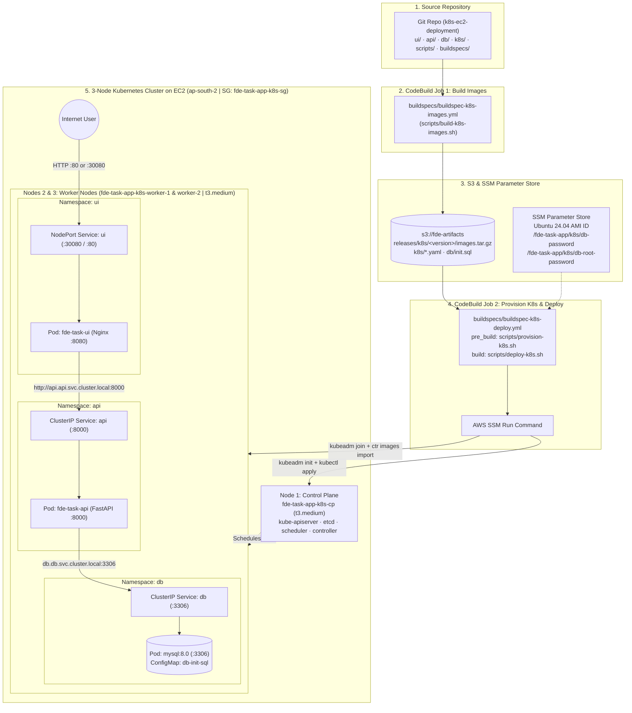

# FDE Task Tracker — 3-Node Kubernetes Cluster on EC2 via AWS CodeBuild (`k8s-ec2-deployment`)

Provisions **3 Ubuntu 24.04 EC2 instances** (**1 Control Plane** + **2 Worker Nodes**) using the AWS CLI, installs **Kubernetes (`kubeadm` v1.31, `kubelet`, `kubectl`, `containerd`, Flannel CNI)**, creates **3 namespaces (`db`, `api`, `ui`)**, and deploys the **3 Docker containers (`db`, `api`, `ui`)** across the cluster via AWS CodeBuild and AWS Systems Manager (SSM).

---

## Architecture Diagram (Mermaid)



*(See [arch.md](file:///Users/ck/repos/fde-task-b2/arch.md) for the sequence diagram and Lucidchart AI prompt.)*

---

## Step-by-Step Execution Sequence

### Step 1: Commit and Push the `k8s-ec2-deployment` Branch
```bash
git add .
git commit -m "Add 3-node Kubernetes cluster provisioning and 3-namespace deployment"
git push -u origin k8s-ec2-deployment
```

---

### Step 2: Check CodeBuild IAM Role Permissions (One-Time Check)
Make sure your CodeBuild service role has permissions for:
- **S3**: `s3:GetObject`, `s3:PutObject`, `s3:ListBucket` on `arn:aws:s3:::fde-artifacts` and `arn:aws:s3:::fde-artifacts/*`
- **SSM**: `ssm:GetParameter`, `ssm:PutParameter`, `ssm:SendCommand`, `ssm:GetCommandInvocation`, `ssm:DescribeInstanceInformation`
- **EC2**: `ec2:Describe*`, `ec2:RunInstances`, `ec2:StartInstances`, `ec2:CreateSecurityGroup`, `ec2:AuthorizeSecurityGroupIngress`, `ec2:CreateTags`
- **IAM**: `iam:GetRole`, `iam:CreateRole`, `iam:AttachRolePolicy`, `iam:PutRolePolicy`, `iam:GetInstanceProfile`, `iam:CreateInstanceProfile`, `iam:AddRoleToInstanceProfile`, `iam:PassRole`

---

### Step 3: Run CodeBuild Job 1 — Build Container Images & Upload to S3
- **Buildspec path in CodeBuild**: `buildspecs/buildspec-k8s-images.yml`
- **Source branch**: `k8s-ec2-deployment`
- **Environment**: Enable **Privileged mode** in CodeBuild project environment settings (required for `docker build`).
- **What executes**:
  1. CodeBuild runs [scripts/build-k8s-images.sh](file:///Users/ck/repos/fde-task-b2/scripts/build-k8s-images.sh).
  2. Validates `ui/app.js`, `api/app.py`, `db/init.sql`, and `k8s/*.yaml`.
  3. Builds `fde-task-ui:<version>` and `fde-task-api:<version>` and pulls `mysql:8.0`.
  4. Saves all 3 images into `images.tar.gz`, copies `k8s/*.yaml` and `db/init.sql`, and uploads to `s3://fde-artifacts/releases/k8s/<version>/` (and updates `s3://fde-artifacts/releases/k8s-LATEST`).

---

### Step 4: Run CodeBuild Job 2 — Provision 3-Node Kubernetes Cluster & Deploy 3 Namespaces/Containers
- **Buildspec path in CodeBuild**: `buildspecs/buildspec-k8s-deploy.yml`
- **Source branch**: `k8s-ec2-deployment`
- **What executes automatically in order**:
  1. **`pre_build` ([scripts/provision-k8s.sh](file:///Users/ck/repos/fde-task-b2/scripts/provision-k8s.sh))**:
     - Creates SSM `SecureString` parameters `/fde-task-app/k8s/db-password` and `/fde-task-app/k8s/db-root-password`.
     - Creates IAM role & instance profile `fde-task-app-k8s-ec2-profile` and Security Group `fde-task-app-k8s-sg` (opens port `80`, NodePort `30080`, and intra-cluster traffic).
     - Launches **3 Ubuntu 24.04 EC2 instances (`t3.medium`)**:
       - `fde-task-app-k8s-cp` (**Control Plane**)
       - `fde-task-app-k8s-worker-1` (**Worker Node 1**)
       - `fde-task-app-k8s-worker-2` (**Worker Node 2**)
     - Installs `containerd` + `kubeadm`, `kubelet`, `kubectl` (`v1.31`) on all 3 nodes.
     - Runs `kubeadm init` on the Control Plane, applies **Flannel CNI**, joins both Worker Nodes via `kubeadm join`, and waits until all 3 nodes are `Ready`.
  2. **`build` ([scripts/deploy-k8s.sh](file:///Users/ck/repos/fde-task-b2/scripts/deploy-k8s.sh))**:
     - Downloads `images.tar.gz` from S3 onto all 3 nodes and imports `mysql:8.0`, `fde-task-api`, and `fde-task-ui` into `containerd` (`ctr -n k8s.io images import`).
     - Applies [k8s/namespaces.yaml](file:///Users/ck/repos/fde-task-b2/k8s/namespaces.yaml) to create the **3 namespaces (`db`, `api`, `ui`)**.
     - Creates `db-credentials` Secrets and `db-init-sql` ConfigMap.
     - Applies [k8s/db.yaml](file:///Users/ck/repos/fde-task-b2/k8s/db.yaml) (`namespace: db`), [k8s/api.yaml](file:///Users/ck/repos/fde-task-b2/k8s/api.yaml) (`namespace: api`), and [k8s/ui.yaml](file:///Users/ck/repos/fde-task-b2/k8s/ui.yaml) (`namespace: ui`).
     - Waits for rollouts across all 3 namespaces, runs the smoke test, and prints the live URLs (`http://<NODE_PUBLIC_IP>:30080/` and `http://<NODE_PUBLIC_IP>/`).

*(Note: If you prefer running everything in **1 single CodeBuild job**, point your CodeBuild project to [buildspecs/buildspec.yml](file:///Users/ck/repos/fde-task-b2/buildspecs/buildspec.yml), which executes Step 3 and Step 4 sequentially in one build.)*

---

### Step 5: Verify or Tear Down
- **Access the App in Browser**: Open any of the 3 node URLs printed at the end of the CodeBuild log:
  - `http://<CONTROL_PLANE_PUBLIC_IP>:30080/` (or `http://<CONTROL_PLANE_PUBLIC_IP>/`)
  - `http://<WORKER_1_PUBLIC_IP>:30080/` (or `http://<WORKER_1_PUBLIC_IP>/`)
  - `http://<WORKER_2_PUBLIC_IP>:30080/` (or `http://<WORKER_2_PUBLIC_IP>/`)
- **Tear Down Cluster**:
  ```bash
  bash scripts/destroy-k8s.sh
  ```


```
Create a detailed AWS Cloud Architecture and CI/CD Pipeline diagram for the "FDE Task Tracker" 3-Node Kubernetes Cluster deployment on Amazon EC2 (branch: k8s-ec2-deployment) in AWS Region ap-south-2 (Hyderabad):

1. Source Control:
- Git Repository (fde-task-app, branch: k8s-ec2-deployment) containing ui/Dockerfile, api/Dockerfile, db/init.sql, k8s/ manifests (namespaces.yaml, db.yaml, api.yaml, ui.yaml), scripts/, and buildspecs/.

2. CI Container Build Pipeline (AWS CodeBuild Job 1 - buildspec-k8s-images.yml):
- Runs scripts/build-k8s-images.sh:
  - Validates UI (Node.js), API (Python 3.12 / FastAPI), DB schema (init.sql), and Kubernetes YAML manifests.
  - Builds Docker container images fde-task-ui:<version> and fde-task-api:<version>, and pulls mysql:8.0.
  - Exports all 3 container images into images.tar.gz, packages k8s/*.yaml and db/init.sql with SHA256SUMS, and uploads to Amazon S3 bucket "s3://fde-artifacts/releases/k8s/<version>/" (updating k8s-LATEST).

3. Secrets & Configuration (AWS SSM Parameter Store):
- Stores Ubuntu 24.04 LTS AMI ID and SecureString parameters /fde-task-app/k8s/db-password and /fde-task-app/k8s/db-root-password.

4. CD Cluster Provisioning & Application Deployment (AWS CodeBuild Job 2 - buildspec-k8s-deploy.yml):
- Step 1 (pre_build - scripts/provision-k8s.sh):
  - Uses AWS CLI to create IAM Instance Profile (fde-task-app-k8s-ec2-profile) and Security Group (fde-task-app-k8s-sg allowing Inbound HTTP Port 80, NodePort 30080 from Internet, and all internal traffic between cluster nodes).
  - Launches 3 Ubuntu 24.04 LTS EC2 instances (t3.medium):
    1) Control Plane Node: fde-task-app-k8s-cp (Role=k8s-control-plane)
    2) Worker Node 1: fde-task-app-k8s-worker-1 (Role=k8s-worker)
    3) Worker Node 2: fde-task-app-k8s-worker-2 (Role=k8s-worker)
  - Via AWS Systems Manager (SSM) Run Command (no SSH / Port 22), installs containerd, kubeadm, kubelet, and kubectl (v1.31) on all 3 nodes, runs "kubeadm init" on the Control Plane, installs Flannel CNI pod network (10.244.0.0/16), and joins Worker Node 1 and Worker Node 2 to the cluster.
- Step 2 (build - scripts/deploy-k8s.sh):
  - Pulls images.tar.gz from S3 onto all 3 nodes and imports the 3 container images into containerd (k8s.io namespace).
  - Applies Kubernetes manifests on the Control Plane to create 3 Namespaces and deploy 3 Containers across the Worker Nodes.

5. Kubernetes Cluster Workload Architecture (3 Namespaces on the Worker Nodes):
- Namespace 1: "ui"
  - Service "ui" (NodePort 30080, plus iptables redirect from Host Port 80 -> 30080).
  - Deployment "ui" (2 replicas running fde-task-ui Nginx container on port 8080, mounting ConfigMap ui-nginx-config).
  - ExternalName Service "api" pointing to api.api.svc.cluster.local.
- Namespace 2: "api"
  - Service "api" (ClusterIP port 8000).
  - Deployment "api" (2 replicas running fde-task-api FastAPI/Uvicorn container on port 8000, reading Secret db-credentials).
  - ExternalName Service "db" pointing to db.db.svc.cluster.local.
- Namespace 3: "db"
  - Service "db" (ClusterIP port 3306).
  - Deployment "db" (1 replica running mysql:8.0 container on port 3306, mounting ConfigMap db-init-sql for db/init.sql and Secret db-credentials).

Show two distinct flows:
- CI/CD & Management Flow: Git -> CodeBuild Job 1 -> S3 (fde-artifacts) -> CodeBuild Job 2 -> AWS SSM Run Command -> Control Plane & 2 Worker Nodes.
- User Request Traffic Flow: Internet User -> HTTP :80 / NodePort :30080 -> Namespace "ui" (Nginx Pod) -> Cross-Namespace DNS (api.api.svc.cluster.local:8000) -> Namespace "api" (FastAPI Pod) -> Cross-Namespace DNS (db.db.svc.cluster.local:3306) -> Namespace "db" (MySQL 8.0 Pod).
```