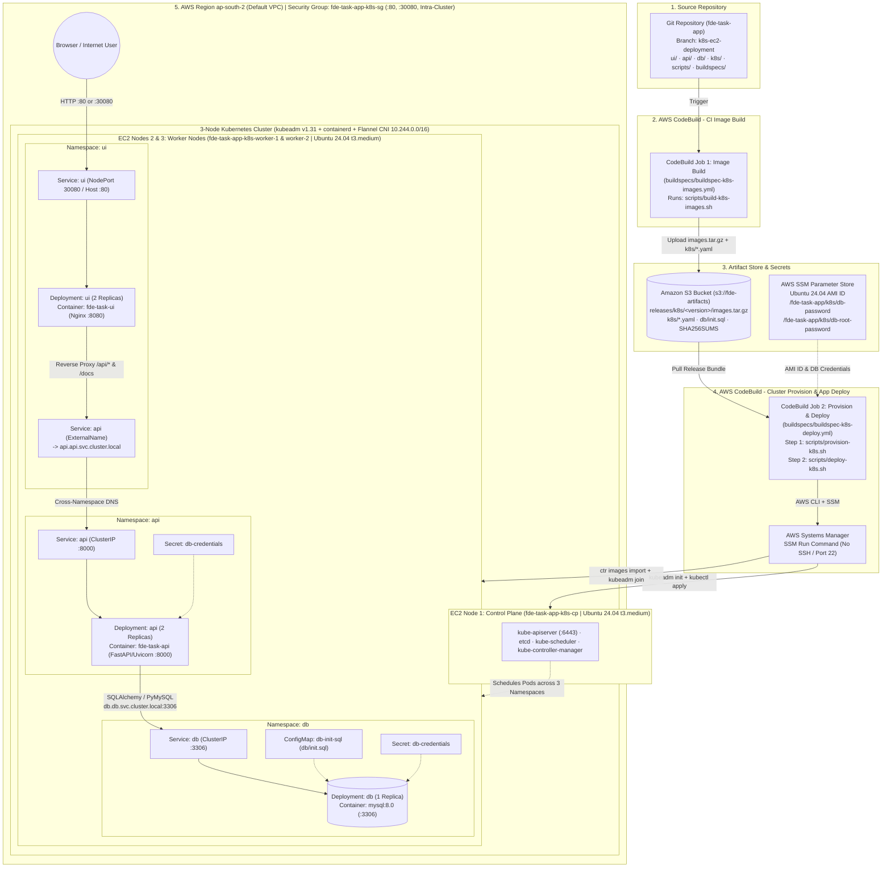
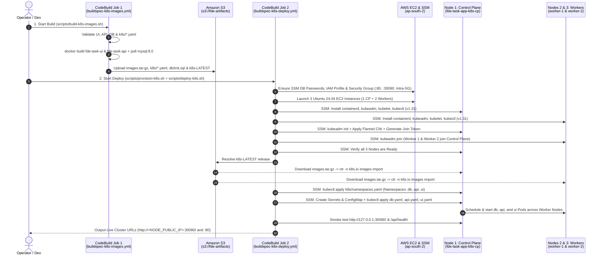

# Architecture Notes — 3-Node Kubernetes Cluster on EC2 (`k8s-ec2-deployment`)

This branch provisions **3 Ubuntu 24.04 EC2 instances** (**1 Control Plane** + **2 Worker Nodes**) in AWS (`ap-south-2`), bootstraps a **Kubernetes (`kubeadm` v1.31 + `containerd` + Flannel CNI)** cluster via AWS CodeBuild and AWS Systems Manager (SSM), creates **3 Kubernetes Namespaces (`ui`, `api`, `db`)**, and deploys the **3 Docker containers (`ui`, `api`, `db`)** across the cluster.

---

## 1. Mermaid Diagram: End-to-End CI/CD + 3-Node Kubernetes Architecture



---

## 2. Mermaid Diagram: Execution Sequence Flow



---

## 3. Lucidchart AI Prompt

Copy and paste the following prompt into Lucidchart’s **Generate diagram with AI**:

```text
Create a detailed AWS Cloud Architecture and CI/CD Pipeline diagram for the "FDE Task Tracker" 3-Node Kubernetes Cluster deployment on Amazon EC2 (branch: k8s-ec2-deployment) in AWS Region ap-south-2 (Hyderabad):

1. Source Control:
- Git Repository (fde-task-app, branch: k8s-ec2-deployment) containing ui/Dockerfile, api/Dockerfile, db/init.sql, k8s/ manifests (namespaces.yaml, db.yaml, api.yaml, ui.yaml), scripts/, and buildspecs/.

2. CI Container Build Pipeline (AWS CodeBuild Job 1 - buildspec-k8s-images.yml):
- Runs scripts/build-k8s-images.sh:
  - Validates UI (Node.js), API (Python 3.12 / FastAPI), DB schema (init.sql), and Kubernetes YAML manifests.
  - Builds Docker container images fde-task-ui:<version> and fde-task-api:<version>, and pulls mysql:8.0.
  - Exports all 3 container images into images.tar.gz, packages k8s/*.yaml and db/init.sql with SHA256SUMS, and uploads to Amazon S3 bucket "s3://fde-artifacts/releases/k8s/<version>/" (updating k8s-LATEST).

3. Secrets & Configuration (AWS SSM Parameter Store):
- Stores Ubuntu 24.04 LTS AMI ID and SecureString parameters /fde-task-app/k8s/db-password and /fde-task-app/k8s/db-root-password.

4. CD Cluster Provisioning & Application Deployment (AWS CodeBuild Job 2 - buildspec-k8s-deploy.yml):
- Step 1 (pre_build - scripts/provision-k8s.sh):
  - Uses AWS CLI to create IAM Instance Profile (fde-task-app-k8s-ec2-profile) and Security Group (fde-task-app-k8s-sg allowing Inbound HTTP Port 80, NodePort 30080 from Internet, and all internal traffic between cluster nodes).
  - Launches 3 Ubuntu 24.04 LTS EC2 instances (t3.medium):
    1) Control Plane Node: fde-task-app-k8s-cp (Role=k8s-control-plane)
    2) Worker Node 1: fde-task-app-k8s-worker-1 (Role=k8s-worker)
    3) Worker Node 2: fde-task-app-k8s-worker-2 (Role=k8s-worker)
  - Via AWS Systems Manager (SSM) Run Command (no SSH / Port 22), installs containerd, kubeadm, kubelet, and kubectl (v1.31) on all 3 nodes, runs "kubeadm init" on the Control Plane, installs Flannel CNI pod network (10.244.0.0/16), and joins Worker Node 1 and Worker Node 2 to the cluster.
- Step 2 (build - scripts/deploy-k8s.sh):
  - Pulls images.tar.gz from S3 onto all 3 nodes and imports the 3 container images into containerd (k8s.io namespace).
  - Applies Kubernetes manifests on the Control Plane to create 3 Namespaces and deploy 3 Containers across the Worker Nodes.

5. Kubernetes Cluster Workload Architecture (3 Namespaces on the Worker Nodes):
- Namespace 1: "ui"
  - Service "ui" (NodePort 30080, plus iptables redirect from Host Port 80 -> 30080).
  - Deployment "ui" (2 replicas running fde-task-ui Nginx container on port 8080, mounting ConfigMap ui-nginx-config).
  - ExternalName Service "api" pointing to api.api.svc.cluster.local.
- Namespace 2: "api"
  - Service "api" (ClusterIP port 8000).
  - Deployment "api" (2 replicas running fde-task-api FastAPI/Uvicorn container on port 8000, reading Secret db-credentials).
  - ExternalName Service "db" pointing to db.db.svc.cluster.local.
- Namespace 3: "db"
  - Service "db" (ClusterIP port 3306).
  - Deployment "db" (1 replica running mysql:8.0 container on port 3306, mounting ConfigMap db-init-sql for db/init.sql and Secret db-credentials).

Show two distinct flows:
- CI/CD & Management Flow: Git -> CodeBuild Job 1 -> S3 (fde-artifacts) -> CodeBuild Job 2 -> AWS SSM Run Command -> Control Plane & 2 Worker Nodes.
- User Request Traffic Flow: Internet User -> HTTP :80 / NodePort :30080 -> Namespace "ui" (Nginx Pod) -> Cross-Namespace DNS (api.api.svc.cluster.local:8000) -> Namespace "api" (FastAPI Pod) -> Cross-Namespace DNS (db.db.svc.cluster.local:3306) -> Namespace "db" (MySQL 8.0 Pod).
```
