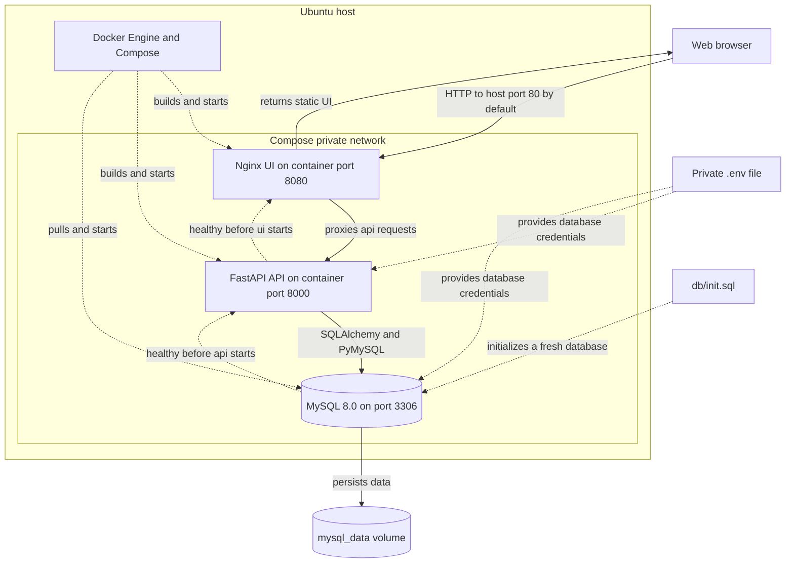

# Architecture Notes

The application is a three-service Docker Compose stack: a static web UI served by Nginx, a FastAPI task API, and MySQL. The UI and API images are built from this repository; Compose pulls the official MySQL image. See the [architecture diagrams and component inventory](./.github/modernize/assessment/engines/facts/architecture-diagram.md) for the code-grounded view.

## Mermaid flow

<!-- mermaid-checked: no \n, no em-dash/en-dash, no {} in labels, subgraphs are id["label"], arrows are -->|"label"|, all subgraphs closed by end, ids unique -->

## Lucidchart prompt

Paste this prompt into Lucidchart AI to create an editable architecture diagram:

> Create a clean, editable architecture diagram for the current FDE Task Tracker repository. Show a browser client and one Docker host running Docker Compose. The host may be a local Ubuntu machine or an Ubuntu 24.04 EC2 instance; do not add AWS services that are not part of this Compose application.
>
> Inside the Compose boundary, show three services on one private Compose network:
>
> - **UI:** Nginx unprivileged 1.29 Alpine container, serving the repository's static HTML, CSS, and JavaScript files on container port 8080. Publish the configurable host port `HTTP_PORT` (default 80) to container port 8080.
> - **API:** FastAPI with Uvicorn on Python 3.12, listening on container port 8000. It provides task CRUD and health endpoints. Do not publish this port on the host.
> - **Database:** MySQL 8.0 listening on container port 3306. Do not publish this port on the host. Persist database files in the named `mysql_data` volume and show `db/init.sql` mounted read-only for initial database setup.
>
> Draw these flows: browser HTTP traffic to the host's published UI port; Nginx serves the static UI and reverse-proxies `/api/` requests to the API service; the API uses SQLAlchemy and PyMySQL to access MySQL; MySQL stores its data in `mysql_data`. Show Docker Compose building the UI and API images from their local folders and pulling the official MySQL image.
>
> Show a private `.env` configuration file supplying database credentials to the API and database, and `HTTP_PORT` to the Compose host-port mapping. Do not display or invent any credential values. Indicate the startup health dependencies: API waits for MySQL health, and UI waits for API health.
>
> Use clear service and port labels, a boundary around the Compose network, and a distinct persistent-volume symbol. Mark only the UI port as publicly reachable; on EC2, SSH is restricted to the operator's IP. Do not show CodeBuild, SSM, S3, load balancers, caches, queues, or external APIs because they are not used by the current application stack.

